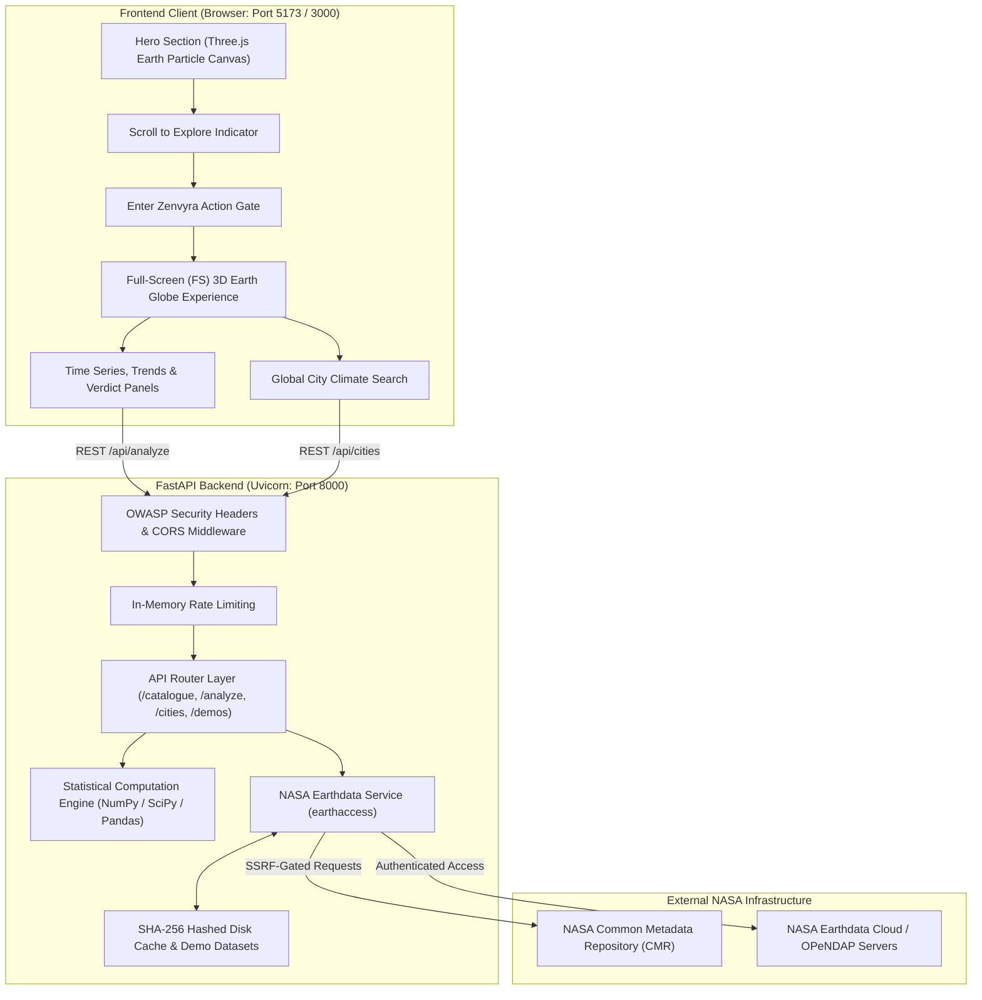

# 🛰️ NASA Data Detectives / Zenvyra: Technical Documentation & Architecture Reference

An interactive, educational Earth science exploration platform empowering students, citizen scientists, and researchers to analyze real NASA Earth observation satellite data, detect climatic trends, and explore multi-dimensional environmental changes through rigorous statistical analysis and immersive 3D visualizations.

---

## 📑 Table of Contents

1. [Executive Summary](#1-executive-summary)
2. [System Architecture Overview](#2-system-architecture-overview)
3. [Technology Stack](#3-technology-stack)
4. [Frontend Architecture & User Experience](#4-frontend-architecture--user-experience)
   - [Hero Section & 3D Earth Particle Orb](#hero-section--3d-earth-particle-orb)
   - [Gated FS Experience & Interaction Sequence](#gated-fs-experience--interaction-sequence)
   - [Interactive 3D Globe & Map Explorer](#interactive-3d-globe--map-explorer)
   - [Climate Risk Indicators & Panels](#climate-risk-indicators--panels)
   - [Localization & Accessibility (i18n)](#localization--accessibility-i18n)
5. [Backend API Architecture](#5-backend-api-architecture)
   - [FastAPI Server & Middleware](#fastapi-server--middleware)
   - [NASA Earthdata Integration & Caching](#nasa-earthdata-integration--caching)
   - [Statistical Analysis Engine](#statistical-analysis-engine)
   - [Complete REST API Reference](#complete-rest-api-reference)
6. [Security & Defensive Architecture](#6-security--defensive-architecture)
7. [Installation & Local Development](#7-installation--local-development)
8. [Testing & Quality Assurance](#8-testing--quality-assurance)
9. [Deployment & Containerization](#9-deployment--containerization)
10. [Repository Directory Structure](#10-repository-directory-structure)

---

## 1. Executive Summary

NASA satellites collect petabytes of Earth observation data every single day. However, for educators, students, and citizen scientists, accessing that data traditionally requires writing specialized Python/Fortran scripts, downloading gigabytes of HDF5/NetCDF files, and manually performing complex anomaly and seasonal statistical corrections.

**NASA Data Detectives (Zenvyra)** solves this problem by offering:
- **Instant Access to Real NASA Observations:** Query surface temperature, precipitation, soil moisture, aerosol optical depth, and vegetation indices spanning decades.
- **Dual Statistical Engine:** Computes both parametric (Ordinary Least Squares) and non-parametric (Theil-Sen estimator, Mann-Kendall rank test) statistics with automatic deseasonalization.
- **Plain-Language Scientific Verdicts:** Translates complex statistical outputs ($p$-values, Kendall's $\tau$, confidence intervals) into clear educational explanations.
- **Immersive 3D Visual Experience:** Interactive Three.js particle orb, dynamic shaders, global city climate search, and an intuitive temporal timeline.

---

## 2. System Architecture Overview



---

## 3. Technology Stack

### Frontend
- **Runtime & Bundler:** Node.js v20+, Vite 6
- **UI Framework:** Vanilla modern ES Modules (`zenvyra_site`) + React 19 with TypeScript (`src/`)
- **3D Graphics & Visuals:** Three.js (particle systems, custom WebGL GLSL shaders, procedural canvas textures)
- **Mapping:** Leaflet with spatial bounding box selector (`L.rectangle`)
- **Typography & Styling:** Tailwind CSS, CSS Custom Properties, Google Fonts (`Playfair Display`, `Fraunces`, `Cinzel`, `Geist`)

### Backend
- **Framework:** FastAPI (Python 3.11+)
- **Server:** Uvicorn ASGI server with hot reloading
- **Validation:** Pydantic v2 schemas with strict geographic bounds
- **Scientific Computing:** NumPy, SciPy (Mann-Kendall test, Student's $t$-distribution, linear regression), Pandas
- **Data Access:** `earthaccess`, Requests, Hashed Disk Cache
- **Security:** In-memory sliding window rate limiter, OWASP Security Headers, Gitleaks

---

## 4. Frontend Architecture & User Experience

The frontend is served from `frontend/zenvyra_site` (configured as Vite root in `vite.config.ts`), with proxying to `http://127.0.0.1:8000/api`.

### Hero Section & 3D Earth Particle Orb
- **File:** `frontend/zenvyra_site/earth-letter.js`, `earth-letter.css`
- **Visuals:** An interactive Three.js particle globe rendered in `<canvas id="earth-canvas">` that responds to cursor hovering and rotation.
- **Narrative Entrance:** Displays **"Hello, Explorer."** followed by an evocative narrative introducing the wonders of Earth and the cosmos.
- **Cipher Decryption Wave:** Letter text renders via an 8-step procedural cuneiform/cipher decoding wave (75ms character mutation intervals staggered by 25ms per word) before settling into smooth typography.

### Gated FS Experience & Interaction Sequence
To ensure smooth user onboarding, the Full-Screen (FS) space experience is strictly gated:
1. **Initial View:** Hero section is displayed with the 3D particle orb and animated narrative text.
2. **Scroll to Explore:** An elegant indicator (`#scroll-explore`) with a bouncing arrow is positioned at the bottom center.
3. **Scroll Action:** When the user scrolls, the indicator immediately fades out (`opacity: 0`). The page smoothly scrolls to reveal the **"Enter Zenvyra"** action section.
4. **Explicit Click Launch:** Scrolling does **not** trigger the 3D globe transition. The full-screen planetary experience is launched **only** when the user explicitly clicks the **"Enter Zenvyra"** button.
5. **Accidental Prevention:** Fast scrolling or wheel events cannot trigger accidental launches.

### Interactive 3D Globe & Map Explorer
- **Components:** `earth-orb.mjs`, `earth-surface.mjs`, `science-textures.mjs`
- **Capabilities:**
  - Interactive sphere rotation, zooming, and point-of-interest clicking.
  - Multi-spectral surface projections representing temperature anomalies, vegetation density, and soil dryness.
  - Real-time procedural fallbacks for low-end devices or WebGL-restricted environments.

### Climate Risk Indicators & Panels
- **Components:** `climate-data.mjs`, `flood-data.mjs`, `science-metrics.mjs`, `global-summary.mjs`
- **Features:**
  - Global city search with latitude/longitude resolution and pre-calculated regional risk profiles.
  - Interactive timeline scrubber (`year-ruler.mjs`) allowing temporal navigation from 2000 to present day.
  - Dynamic climate metrics: temperature shifts (°C), soil saturation ($m^3/m^3$), precipitation volatility (mm/month), and flood susceptibility indices.

### Localization & Accessibility (i18n)
- **Files:** `frontend/zenvyra_site/locales/extra.mjs`, `locales/es.mjs`, `i18n.mjs`
- Multi-language support (English, Spanish, and extensible keys).
- Semantic HTML tags, aria-labels, and high-contrast color palettes for accessibility.

---

## 5. Backend API Architecture

### FastAPI Server & Middleware
The backend application (`backend/app/main.py`) provides high-performance asynchronous endpoints with production-ready middleware:
- **`SecurityHeadersMiddleware`:** Injects `Content-Security-Policy`, `X-Content-Type-Options: nosniff`, `X-Frame-Options: DENY`, `Strict-Transport-Security`, and `Permissions-Policy`.
- **`CORSMiddleware`:** Restricts origin access to designated local and production URLs.
- **`RateLimitMiddleware`:** In-memory sliding window limiter preventing denial-of-service and downstream API quota exhaustion.

### NASA Earthdata Integration & Caching
- **File:** `backend/app/services/nasa_data.py`
- Utilizes `earthaccess` to authenticate with NASA Earthdata Login.
- **SHA-256 Hashed Disk Cache:** API responses are cached locally on disk keyed by `sha256(variable + bbox + dates)` to ensure lightning-fast response times and offline capability.
- **Offline Fallbacks:** Includes pre-packaged datasets in `backend/app/data/demo_cache/` (e.g., Arctic Temperature, Sahel Precipitation, Amazon Soil Moisture) so the application functions seamlessly even without active internet or NASA credentials.

### Statistical Analysis Engine
- **File:** `backend/app/services/stats_engine.py`
- **Deseasonalization:** Calculates multi-year monthly climatology ($12$ monthly means) and subtracts it from each observation to eliminate seasonal sinusoidal cycles:
  $$\text{Anomaly}(y, m) = \text{Value}(y, m) - \text{Climatology}(m)$$
- **Ordinary Least Squares (OLS):** Computes linear slope, intercept, standard error, $R^2$, and converts slope to **change per decade**.
- **Theil-Sen Robust Estimator:** Computes the median of all pairwise slopes between data points, providing resistance against sudden anomaly spikes or sensor outliers.
- **Mann-Kendall Rank Test:** Non-parametric test for monotonic trends; computes Kendall's $\tau$, variance $S$, and two-tailed $z$-score and $p$-value.
- **Plain-Language Verdict:** Evaluates statistical significance at $\alpha = 0.05$ ($95\%$ confidence) and generates student-friendly summaries (e.g. *"Statistically significant warming detected (+0.72°C/decade, p < 0.001)"* vs *"No clear long-term trend detected"*).

---

### Complete REST API Reference

#### 1. System Health
- **Endpoint:** `GET /health`
- **Description:** Verifies service readiness and environment.
- **Response:**
  ```json
  {
    "status": "healthy",
    "service": "NASA Data Detectives",
    "version": "1.0.0",
    "environment": "development"
  }
  ```

#### 2. Variables Catalogue
- **Endpoint:** `GET /api/catalogue`
- **Description:** Returns the 5 core Earth Science variables, their sphere, NASA product ID, units, and educational descriptions.
- **Variables Included:**
  1. `surface_temp`: MERRA-2 2-meter air temperature (°C)
  2. `precipitation`: GPM IMERG monthly precipitation accumulation (mm/month)
  3. `soil_moisture`: SMAP / GLDAS soil moisture ($m^3/m^3$)
  4. `aerosol`: MODIS Terra/Aqua 550nm Aerosol Optical Depth
  5. `ndvi`: MODIS Terra Normalized Difference Vegetation Index

#### 3. Analyze Climate Trends
- **Endpoint:** `POST /api/analyze`
- **Payload Schema:**
  ```json
  {
    "variable": "surface_temp",
    "bbox": [-168.0, 60.0, -130.0, 75.0],
    "start_date": "2000-01",
    "end_date": "2023-12",
    "deseasonalize": true
  }
  ```
- **Response Highlights:**
  - `time_series`: Array of timestamps and raw values.
  - `anomalies`: Deseasonalized monthly anomaly series.
  - `trend_per_decade`: Trend magnitude scaled to a 10-year period.
  - `ols`: Slope, intercept, $R^2$, standard error, $p$-value.
  - `theil_sen`: Robust median slope and intercept.
  - `mann_kendall`: Kendall's $\tau$, $z$-score, $p$-value, trend verdict.
  - `verdict`: Plain-language explanation for students and educators.

#### 4. Pre-Packaged Demo Scenarios
- **Endpoint:** `GET /api/demos`
- **Description:** Fetches instant educational demo datasets (Arctic Polar Cap, Amazon Basin, Sahel Drought Belt).

#### 5. Worldwide Cities Search
- **Endpoint:** `GET /api/cities?q={search_term}`
- **Description:** Autocomplete and lookup for global city coordinates and associated climate risk indicators.

---

## 6. Security & Defensive Architecture

- **SSRF Prevention:** The backend implements a strict outbound hostname allowlist (`*.nasa.gov`, `*.earthdata.nasa.gov`). Arbitrary external URL fetching is strictly disallowed.
- **Input Bounds Validation:** Pydantic validators enforce valid geographic coordinates:
  - Latitude: $[-90.0, 90.0]$
  - Longitude: $[-180.0, 180.0]$
  - Date ranges: Valid format `YYYY-MM`, $1980 \le \text{Year} \le \text{Current}$.
- **Secret Hygiene:** NASA Earthdata credentials reside exclusively in `.env` files. Pre-commit hooks with **Gitleaks** prevent keys or tokens from being committed to version control.
- **OWASP Header Hardening:** Automatic injection of strict Content Security Policies, frame restriction (`X-Frame-Options: DENY`), and MIME-sniffing prevention.

---

## 7. Installation & Local Development

### Prerequisites
- **Node.js** (v20+ recommended)
- **Python** (v3.11 - v3.14)
- **Git**

### Step-by-Step Setup

1. **Clone the Repository:**
   ```bash
   git clone https://github.com/pranathikr/nasa-copy.git
   cd nasa-copy/nasa/nasa
   ```

2. **Configure Environment Variables:**
   ```bash
   cp .env.example .env
   ```
   *(Optional)* Enter your NASA Earthdata credentials in `.env` if querying live, non-cached datasets.

3. **Setup and Run Backend:**
   ```bash
   cd backend
   python -m venv .venv
   # Windows:
   .venv\Scripts\activate
   # Linux/macOS:
   source .venv/bin/activate

   pip install -r requirements.txt
   python -m uvicorn app.main:app --host 127.0.0.1 --port 8000 --reload
   ```

4. **Setup and Run Frontend:**
   ```bash
   cd ../frontend
   npm install
   npm run dev -- --host 127.0.0.1
   ```

5. **Open in Browser:**
   - **Frontend Application:** [http://127.0.0.1:5173/](http://127.0.0.1:5173/)
   - **Interactive API Swagger Docs:** [http://127.0.0.1:8000/docs](http://127.0.0.1:8000/docs)

---

## 8. Testing & Quality Assurance

The project includes unit and integration tests covering security, statistics, and data integrity:

```bash
cd backend
pytest -v
```

### Test Suites Included:
- `test_health.py`: Verifies server health check response and headers.
- `test_stats_engine.py`: Validates OLS, Theil-Sen, and Mann-Kendall outputs against reference analytical values.
- `test_nasa_data.py`: Tests NASA API fetching, disk caching, and offline demo dataset consistency.
- `test_abuse_and_security.py`: Tests rate limiting, invalid bounding box rejection, and malformed payload handling.

---

## 9. Deployment & Containerization

### Docker Compose
Run the entire platform in isolated containers:
```bash
docker-compose up --build
```
- Frontend container runs Nginx serving optimized static build on port 3000.
- Backend container runs Uvicorn on non-root user image on port 8000.

### Render / Cloud Deployment
The repository includes a ready-to-use `render.yaml` specification for deploying both the FastAPI web service and static frontend on cloud providers.

---

## 10. Repository Directory Structure

```text
nasa/
├── .github/                     # CI/CD workflows and automated checks
│   └── workflows/
│       └── secret-scan.yml      # Automated Gitleaks secret scanner
├── .env.example                 # Environment configuration template
├── .gitleaks.toml               # Gitleaks rule definitions
├── docker-compose.yml           # Production multi-container composition
├── DOCUMENTATION.md             # Complete system & architecture documentation
├── README.md                    # Quickstart guide
├── render.yaml                  # Cloud deployment configuration
│
├── backend/                     # FastAPI Python Server
│   ├── app/
│   │   ├── api/                 # Endpoint route controllers
│   │   │   ├── analyze.py       # POST /analyze statistical endpoint
│   │   │   ├── catalogue.py     # GET /catalogue NASA variables catalog
│   │   │   ├── cities.py        # GET /cities global database lookup
│   │   │   └── demos.py         # GET /demos educational scenarios
│   │   ├── core/                # Configuration, CORS & rate limiters
│   │   ├── data/                # Static catalogs & demo JSON cache
│   │   ├── services/            # Statistical engine & NASA data fetcher
│   │   └── main.py              # Application factory & middleware
│   ├── tests/                   # Pytest automated test suites
│   ├── requirements.txt         # Pinned Python package dependencies
│   └── Dockerfile               # Secure non-root container configuration
│
└── frontend/                    # Vite + React + Vanilla ES Modules
    ├── zenvyra_site/            # Active site root (Vite root)
    │   ├── index.html           # Main visual experience & DOM tree
    │   ├── earth-letter.js      # Hero canvas, cipher decoding, scroll gate
    │   ├── earth-letter.css     # Typography, keyframe animations, UI styling
    │   ├── earth-orb.mjs        # Three.js 3D Earth particle system
    │   ├── climate-data.mjs     # Climate data adapters & calculations
    │   ├── place-search.mjs     # Worldwide city spatial search
    │   ├── science-metrics.mjs  # Scientific metrics calculations
    │   └── locales/             # Multi-language translation dictionaries
    ├── src/                     # React 19 / TypeScript component library
    ├── package.json             # NPM dependencies & scripts
    ├── vite.config.ts           # Vite proxy & server configuration
    └── Dockerfile               # Production multi-stage Nginx container
```

